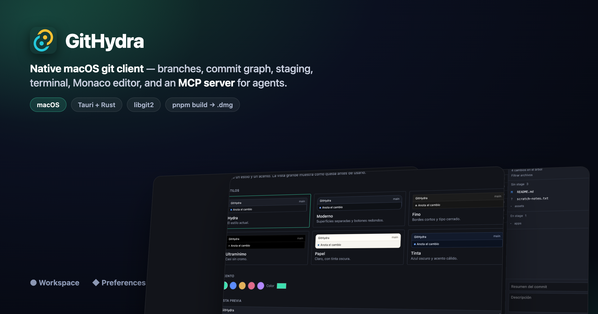

# GitHydra



Desktop Git client for macOS. This release is the foundation: open a repository, browse branches and history, and the shell for the graph, staging, terminal, and editor.

## Requirements

- Node.js 22+
- pnpm 11
- Rust stable (rustfmt and clippy)
- CMake (required by `git2` / libgit2 at compile time)

## Install

```bash
pnpm install
pnpm install-app
```

Open a folder from the window. The first repository view shows the Cursor config. Copy it into `.cursor/mcp.json` and restart Cursor. The agent can stage files and propose a commit message in this repo. **Confirm** in the window is still the commit.

## Commands

```bash
pnpm install
pnpm dev          # development window
pnpm install-app  # rebuild, install to /Applications, and open GitHydra
pnpm build        # .app and .dmg only, no install (docs/DMG.md)
pnpm mcp          # MCP server over stdio
pnpm check        # Biome, format, clippy, and tests
```

Apple code signing for distributing the `.app` off this machine is out of scope for this phase. Building on Windows is not set up; the gaps are in [docs/WINDOWS.md](docs/WINDOWS.md).

Build order is in [docs/ROADMAP.md](docs/ROADMAP.md). Layering is in [docs/ARCHITECTURE.md](docs/ARCHITECTURE.md); MCP in [packages/mcp/README.md](packages/mcp/README.md).
