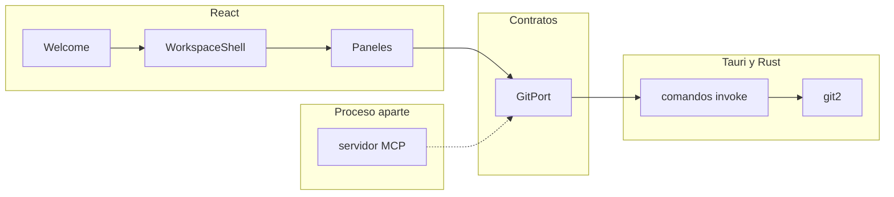

# Arquitectura de GitHydra

GitHydra es un cliente git de escritorio (fase 0: fundación). La interfaz se parece a un cliente gráfico de git, pero esta fase solo deja la estructura, la lectura del repositorio y los puntos de extensión.

## Capas

- `apps/desktop` — ventana Tauri, React y el módulo Rust que abre repositorios con `git2`.
- `packages/contracts` — DTOs y la interfaz `GitPort`. No tiene I/O.
- `packages/mcp` — servidor stdio para Cursor y otros clientes. Hoy devuelve la misma forma de datos, vacía. No va dentro del binario de la app.

La UI no ejecuta `git` ni importa `git2`. Solo llama a `invoke` a través de `TauriGitAdapter`.

## Features

Cada panel vive en `apps/desktop/src/features/<nombre>` y lee el store o los hooks. No escribe en el repositorio.

| Feature  | Fase 0                                                      | Después                                 |
| -------- | ----------------------------------------------------------- | --------------------------------------- |
| welcome  | Abrir carpeta, validar repo, recientes                      | Clonar por URL                          |
| branches | Lista local y remota                                        | Checkout                                |
| history  | Commits paginados, autor, fecha, badges de punta            | Selección y diff                        |
| graph    | Columna reservada                                           | Layout con `parentShas`                 |
| staging  | Lista de lectura del árbol de trabajo y formulario inactivo | Stage y commit                          |
| terminal | xterm estático                                              | PTY                                     |
| editor   | Monaco de solo lectura con un archivo de ejemplo            | Abrir el archivo del diff y sugerencias |

El estado de la sesión (`path`, nombre, rama, HEAD) está en `src/stores/repo-session.ts`.

## Errores

Rust serializa los fallos como `CODE|mensaje`. Códigos: `NOT_A_REPO`, `IO_ERROR`, `NOT_IMPLEMENTED`. El adaptador los convierte en `GitClientError`.

## Comandos

Desde la raíz del monorepo:

- `pnpm dev` — ventana de desarrollo.
- `pnpm build` — app de macOS (`.app` / `.dmg`). El procedimiento del disco está en [DMG.md](DMG.md).
- `pnpm mcp` — servidor MCP por stdio.
- `pnpm check` — Biome, rustfmt, clippy y tests de Rust.

`git2` se compila sin las features `https` y `ssh`. Al añadir el clon remoto hay que activarlas a propósito.

## Roadmap

La secuencia viva, con un solo paso activo, está en [ROADMAP.md](ROADMAP.md). Esta página describe las capas; el orden de construcción está allí.

## Dependencias

pnpm workspaces separan la app del MCP. Renovate agrupa `@tauri-apps/*`, `tauri` y React. La toolchain de Rust queda fijada en `rust-toolchain.toml` (`stable` + rustfmt + clippy). Node `>= 22`.
